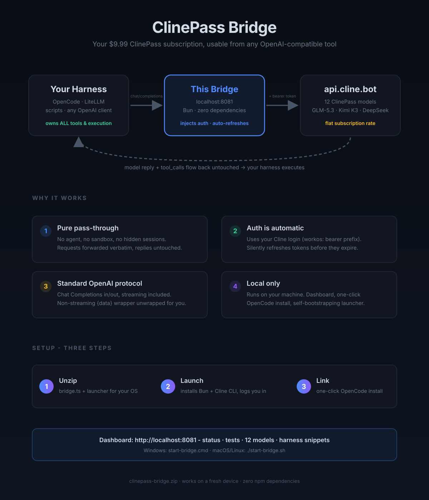
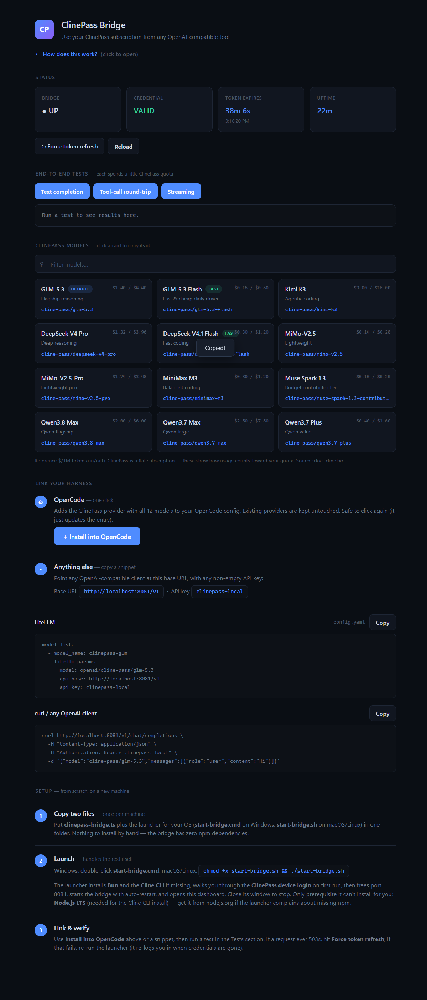

# RE: ClinePass to API

Use your ClinePass subscription from any OpenAI-compatible tool. A tiny local proxy turns ClinePass auth into a plain OpenAI-style API, so OpenCode, LiteLLM, curl, or your own scripts can spend your subscription quota. No API keys to manage.

## Why

ClinePass ($9.99/mo) is good value on open coding models, but it only works inside Cline. This bridge unlocks it for everything else: your harness keeps 100% of execution (tools, MCP, agents) and treats ClinePass as just another model API.

## Quick start

1. Grab the zip from Releases (or clone this repo). To run, you need `clinepass-bridge.ts` plus the launcher for your OS.
2. Windows: double-click `start-bridge.cmd`. macOS/Linux: `chmod +x start-bridge.sh && ./start-bridge.sh`.
3. The launcher installs Bun and the Cline CLI if missing, walks you through the ClinePass device login on first run, then starts the bridge and opens the dashboard.
4. In the dashboard, click Install into OpenCode (or copy a snippet for LiteLLM/curl), restart your harness, pick a ClinePass model.

The one prerequisite the launcher cannot install for you is Node.js LTS (needed for the Cline CLI install). It tells you if it is missing.

## Dashboard

Lives at http://localhost:8081/ while the bridge is up:

- Status: bridge uptime, credential health, token expiry countdown
- Tests: one-click text, tool-call, and streaming checks
- Models: the 12 official ClinePass models with reference pricing, click a card to copy its id
- Link harness: one-click OpenCode install plus LiteLLM/curl snippets
- Setup guide: the same steps as above, on the page itself

## How it works

Your harness sends standard OpenAI Chat Completions to `http://localhost:8081/v1`. The bridge injects your Cline login as a `workos:` bearer token, refreshes tokens before they expire, unwraps the `{data}` envelope on non-streaming replies, and pipes streaming SSE bytes through untouched. Tool calls pass through verbatim, so all execution stays in your harness. Full protocol and auth notes are in [clinepass-bridge.md](clinepass-bridge.md).

## Files

| File | What |
|---|---|
| `clinepass-bridge.ts` | The proxy and dashboard. Run with `bun clinepass-bridge.ts` |
| `start-bridge.cmd` / `start-bridge.ps1` | Windows launcher: numbered stages, health-gated start, logs to `setup.log` |
| `start-bridge.sh` | macOS/Linux launcher, same flow |
| `clinepass-bridge.md` | Full technical notes (auth findings, endpoints, troubleshooting) |

## Troubleshooting

- Red "No ClinePass login" banner: re-run the launcher, or run `cline auth --provider cline-pass` by hand.
- 503 from a harness: hit Force token refresh in the dashboard.
- Port 8081 busy: the launcher frees it automatically on start.
- Reasoning models returning 500 "empty response content": retry without `max_tokens`.
- Launcher failed: open `setup.log` and `bridge.log` in the bridge folder, they record every stage.

## Notes

- Unofficial project, not affiliated with Cline. Requires a paid ClinePass subscription.
- Everything runs on your machine. Model calls go to Cline's API exactly as the Cline app would send them.
